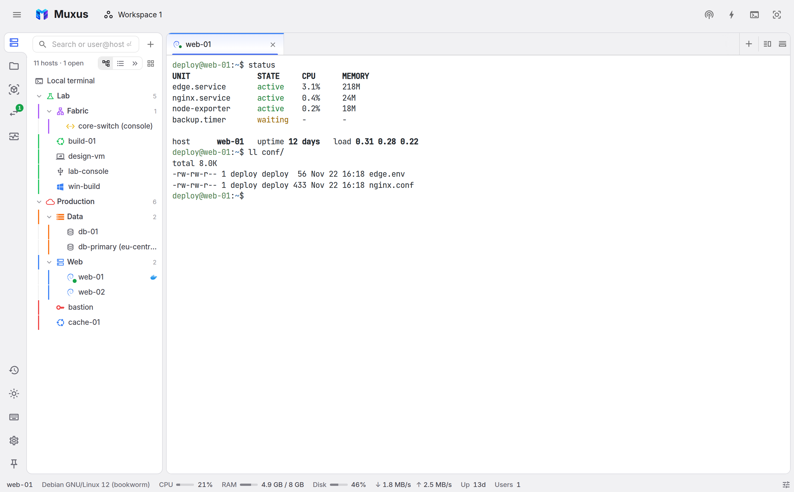

# Muxus

Muxus is a free, open-source SSH, Telnet and serial client with RDP and VNC remote desktops
and a NETCONF, gNMI, gNOI and gNSI workbench for network devices.
Split panes, saved workspaces, SFTP, a remote editor, saved tunnels, and images in the terminal.

**The docs are the main entry point:** [muxus.app](https://muxus.app/)



## Start Here

- [Install Muxus](https://muxus.app/install/)
- [Quickstart](https://muxus.app/quickstart/)
- [User guide](https://muxus.app/guide/)
- [Reference](https://muxus.app/reference/)
- [Contributing and development](https://muxus.app/community/)
- [Desktop releases](https://github.com/FloSch62/muxus/releases)

## Run From Source

Requires Node.js >= 24.17 and pnpm:

```bash
pnpm install
pnpm build
pnpm start
```

For development setup, architecture, the security model and how the screenshots are
generated, use the docs.

## Support

<a href="https://www.buymeacoffee.com/FloSch62">
  
</a>

## License

[MIT](./LICENSE)
